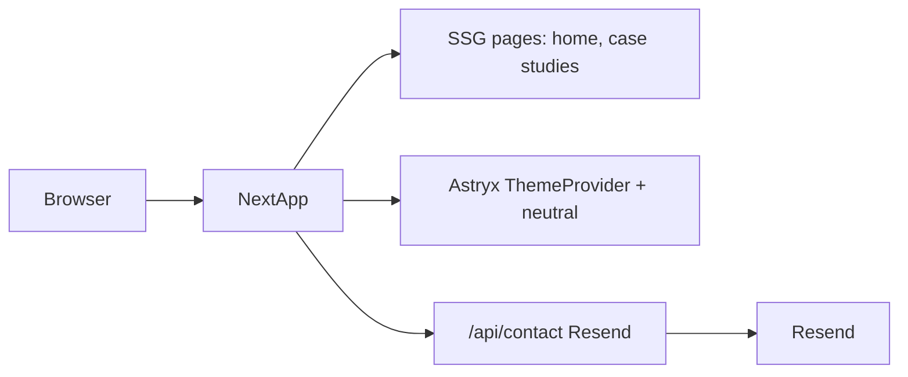

# Raven Platforms × Astryx redesign

Date: 2026-11-17  
Status: approved for implementation planning  
Site: Raven Platforms (ai.onraven.ca)

## Goal

Rebuild the Raven marketing site on Meta’s Astryx design system so the UI is calmer, themeable, and agent-ready, without losing core content, SEO, bilingual support, or the Resend contact flow.

## Decisions

| Topic | Choice |
|-------|--------|
| Adoption | Real Astryx (`@astryxdesign/core` + React 19), not a visual remix of static HTML |
| Theme | `@astryxdesign/theme-neutral` |
| Framework | Next.js App Router on Vercel (Approach A) |
| Content | Keep home substance + case studies + EN/ES + contact; slim visual chrome so the page feels less overwhelming |
| Non-goals | CMS, blog, auth, dashboards, Tailwind-as-primary styling, new email product |

## Architecture



- Next.js 15+, React 19, `@astryxdesign/core`, `@stylexjs/stylex`, `@astryxdesign/theme-neutral`, `@astryxdesign/cli`
- Root layout wraps the app in Astryx `Theme` using the generated themes module (`themes[defaultThemeSlug]`)
- Pages are mostly static (SSG); contact is a serverless App Router route
- Deploy stays on the existing Vercel project
- Runtime cuts: Three.js cosmos, HUD clocks, orbit SVG interaction

### App structure

```
app/
  layout.tsx              # ThemeProvider, fonts, shell
  page.tsx                # home sections
  case-studies/
    page.tsx
    [slug]/page.tsx
  api/contact/route.ts
components/               # SiteNav, SiteFooter, section pieces
content/                  # copy, services, case studies, i18n
public/                   # favicon, og, gallery assets as needed
```

## Pages and IA

### Routes

- `/` - home (slimmed)
- `/case-studies` - listing
- `/case-studies/[slug]` - seven existing studies (prevsi, foundrylane, wemoverd, rookiebets, rmj-transportation, ledgerport, gatherstay)
- `/api/contact` - Resend (same behavior as today’s `api/contact.js`)

### Home (top → bottom)

1. **Nav** - Raven brand, Services, Clients, Case studies, Contact CTA; OnRaven / Prevsi as quiet text links
2. **Hero** - brand-forward “Raven Platforms”, one headline, one supporting sentence, one primary CTA to contact. No HUD, planet, or ticker
3. **Clients** - simple logo/name row (not a racing marquee)
4. **Products** - OnRaven + Prevsi, short copy + outbound link each
5. **Services** - flat list/grid of the ten existing services (no orbit map)
6. **Selected work** - first 6 case-study cards from the shared content list; “See all” → `/case-studies`
7. **FAQ** - current Q&As in a clean accordion
8. **Contact** - form + email
9. **Footer** - legal/location, socials, language toggle

### Dropped home chrome

- Cosmos / Three.js backdrop
- Mission clock and signal HUD
- Orbit services interaction
- Full site gallery wall as a home section (images may remain under `public/` for later)

## Visual system

- Base: `@astryxdesign/theme-neutral` (ship light appearance in v1; no custom dark-mode work)
- Light brand extension via `defineTheme({ extends: importedTheme, ... })` only if needed for Raven naming/accent; do not revive the purple glow / void palette
- Typography comes from the theme; retire Space Grotesk / JetBrains HUD stack as the primary UI type
- Motion: one calm hero entrance; otherwise quiet. Respect `prefers-reduced-motion`
- Primary building blocks: Astryx Button, layout stacks, form controls, cards, accordion patterns; prefer Astryx templates (e.g. centered hero, contact form, card grid) over bespoke chrome

## Content, i18n, SEO

- Move EN/ES strings and case-study bodies into `content/` modules (typed objects)
- Same copy by default; only trim lines that fight the calmer tone
- Selected-work strip and case-study routes share one case-study list
- Keep SEO: Next metadata API, JSON-LD, `robots.txt`, `sitemap.xml`, `llms.txt`, canonical hosts (`ai.onraven.ca` / `ai.onraven.com`)
- i18n: keep EN/ES via the existing simple toggle/query pattern; do not introduce a heavy i18n framework in v1

## Contact

- Port `api/contact.js` to `app/api/contact/route.ts`
- Preserve: Resend API, `FROM` / notify recipients, HTML escaping, email validation, CORS/`ALLOWED_ORIGIN`, success and error responses
- Env: `RESEND_API_KEY`, optional `ALLOWED_ORIGIN`
- UI: Astryx form controls with clear status (success, validation, send failure)

## Migration sequence

1. Scaffold Next.js + install Astryx packages; run `npx @astryxdesign/cli init` and `theme add neutral`
2. Root layout, ThemeProvider, SiteNav / SiteFooter
3. Home sections (slim IA)
4. Case studies listing + `[slug]` pages from content modules
5. Contact API + form wiring
6. SEO/static assets; remove obsolete static HTML/CSS/JS (old `index.html`, case-study HTML, cosmos scripts)
7. Smoke: home, one case study, contact submit, both languages, mobile width

## Testing

- One small unit or assert-based check for contact validation helpers
- Manual smoke via local Next / `vercel dev`
- No new e2e suite in v1

## Risks

- Astryx is in beta; APIs and theme packages may shift
- StyleX + Next config needs correct setup (follow Astryx example-nextjs / example-nextjs-stylex)
- Replacing the root from static HTML to Next must preserve Vercel env vars and production domains
- Slimming the gallery/orbit chrome changes the visual brand; content remains, atmosphere does not

## Out of scope

- Rewriting case-study narratives
- New product marketing pages beyond OnRaven / Prevsi links
- Building a CMS or headless content pipeline
- Force-adopting dark gothic palette (rejected in favor of neutral)
)